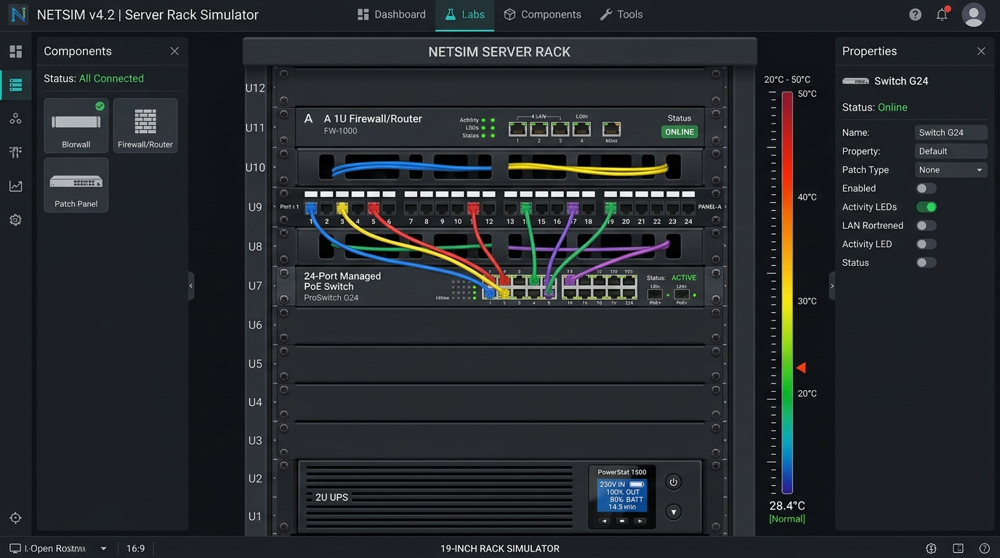
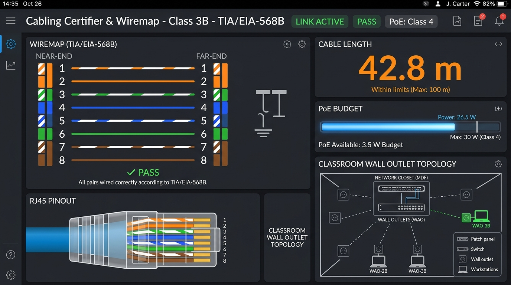
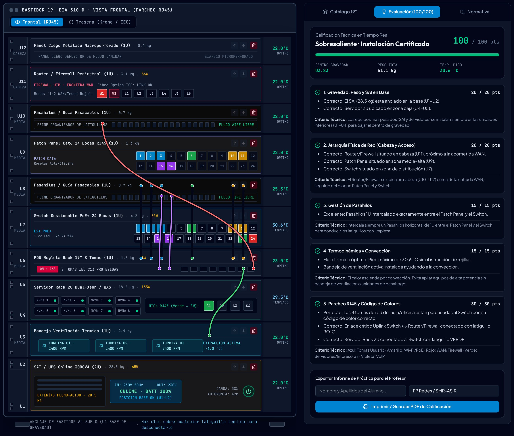

<div align="center">
  <a href="https://www.unfantasmaenelsistema.com/" target="_blank">
    
  </a>

  # Constructor Visual de Rack 19" y Patch Panel (`RackLab 19"`)

  **Simulador Interactivo y Didáctico de Cableado Estructurado, Bastidores de Telecomunicaciones (EIA-310-D), Termodinámica y Crimpado RJ45 (TIA/EIA-568B)**

  [](https://www.unfantasmaenelsistema.com/)
  [-10b981?style=for-the-badge)](#normativa-técnica-aplicada)
  [](#codificación-de-colores-de-latiguillos-ansitia-606-c)
  [](#despliegue-en-github-pages)
</div>

---

## Descripción Pedagógica

**RackLab 19"** es un laboratorio virtual interactivo diseñado por **[Un Fantasma en el Sistema](https://www.unfantasmaenelsistema.com/)** para módulos formativos de **Formación Profesional e Ingeniería de Redes** (*Redes Locales, Sistemas Microinformáticos y Redes - SMR, Administración de Sistemas Informáticos en Red - ASIR, Sistemas de Telecomunicaciones e Informáticos - STI*).

Permite al alumnado practicar de forma visual, realista y sin riesgo físico el diseño e instalación de un **armario rack de 19 pulgadas (12U)** aplicando criterios reales de ingeniería:

1. **Seguridad Mecánica y Centro de Gravedad**: Ubicación del **SAI / UPS (28,5 kg)** en la base (`U1–U2`) y servidores pesados (`18,2 kg`) en la zona inferior para impedir el vuelco del bastidor.
2. **Jerarquía Física de Red**: Instalación del **Router / Firewall perimetral** en cabeza (`U10–U12`, próximo a la acometida WAN), seguido del bloque de distribución (**Patch Panel Cat6** y **Switch Gestionable PoE+**) separados por **Pasahilos horizontales (1U)**.
3. **Gestión Térmica y Convección Natural**: Simulación termodinámica por unidad `U` (`°C`), penalización por apilamiento térmico de equipos activos o bloqueo de rejillas por cables sin guía, y refrigeración forzada mediante **bandejas de ventilación (1U)**.
4. **Parcheo de Tomas de Red del Aula/Oficina y Código de Colores**: Consolidación desde las rosetas de pared (`TO-01`..`TO-08`) hacia los bloques traseros **IDC Krone 110** del Patch Panel y conexión frontal mediante latiguillos RJ45 flexibles hacia el Switch.
5. **Certificación Cat6 (Clase E), Presupuesto PoE+ y Taller de Crimpado RJ45 (`T568B` / `T568A`)**: Comprobador estilo *Fluke* con mapa de hilos 1–8, longitud de tirada, atenuación (`dB`), margen `NEXT`, consumo PoE (`IEEE 802.3af/at`) y entrenador interactivo de crimpado de conectores 8P8C.

---

## Capturas de Pantalla

### 1. Bastidor Interactivo de 19 Pulgadas, Latiguillos SVG y Termometría por Unidad `U`


### 2. Certificador de Cableado Cat6, Presupuesto PoE+ y Entrenador de Crimpado T568B


### 3. Evaluación Didáctica sobre 100 Puntos, Centro de Gravedad y Termodinámica


---

## Características Principales

- **Vista Dual del Bastidor (Frontal RJ45 vs. Trasera IDC Krone 110 y Eléctrica IEC C13)**:
  - **Vista Frontal**: Chasis interactivos con pantallas LCD, bahías NVMe hot-swap, bocas RJ45 clicables y latiguillos con curvas Bézier en SVG que se canalizan por los peines del **Pasahilos 1U**.
  - **Vista Trasera**: Inspección de los 24 bloques **IDC Krone 110** donde se punzonan los cables rígidos procedentes de las rosetas del aula/oficina, fuentes redundantes `80+ Platinum`, tomas de tierra `M6` y distribución eléctrica respaldada desde el **SAI** y la **PDU**.
- **3 Prácticas Guiadas + Generador de Exámenes Aleatorios**:
  - **Práctica 1 (Inicial)**: *Rack de Aula de Informática (12U)* — corrección de errores de peso y parcheo de 6 rosetas de aula.
  - **Práctica 2 (Intermedio)**: *Micro-CPD de Oficina & Servidor 2U (12U)* — incluye servidor de virtualización, refrigeración activa y 8 tomas mixtas.
  - **Práctica 3 (Avanzado)**: *Diseño Desde Cero* — bastidor vacío sin pistas iniciales.
  - **Modo Examen Aleatorio (`#Semilla`)**: Genera al instante una combinación única de rosetas de aula y bocas de Patch Panel para evaluaciones individuales en el aula.
- **Autoevaluación en Tiempo Real (0–100 pts) e Informe Imprimible / Exportación `.JSON`**:
  - Rúbrica desglosada en 5 criterios técnicos con retroalimentación instantánea.
  - Guardado y carga de proyectos en archivo `.json` para entregar al docente, más generación de informe en PDF/impresión con el nombre y grupo del alumno.

---

## Normativa Técnica Aplicada

### 1. Distribución Vertical de Unidades `U` (EIA-310-D)

| Zona del Rack | Unidades `U` | Equipos Recomendados | Justificación Técnica y Didáctica |
| :--- | :---: | :--- | :--- |
| **Cabeza (Superior)** | `U11 – U12` | Router / Firewall UTM, Panel Ciego | Cercanía a la acometida superior de fibra óptica / WAN y rápida visualización del enlace crítico. |
| **Distribución Alta** | `U7 – U10` | Patch Panel 24p, Pasahilos 1U, Switch 24p PoE+ | Recibe los mazos de cableado estructurado horizontal y organiza los latiguillos sin obstruir rejillas. |
| **Zona Media** | `U6` | PDU Eléctrica 1U | Distribuye la energía protegida por el SAI al resto de equipos. |
| **Zona Inferior** | `U3 – U5` | Bandeja de Ventilación 1U (`U3`) + Servidor Rack 2U Dual-Xeon / NAS (`18,2 kg`, `U4–U5`) | Segundo elemento más pesado; va cerca de la base, separado del SAI por la bandeja de ventilación para evitar el apilamiento térmico. |
| **Base (Suelo)** | `U1 – U2` | SAI / UPS Online 3000VA (`28,5 kg`) | **Obligatorio en la base** por el elevado peso de sus baterías para rebajar el centro de gravedad. |

### 2. Codificación de Colores de Latiguillos (ANSI/TIA-606-C)

| Color del Latiguillo | Uso en el Armario Rack | Servicio / VLAN Asociada |
| :--- | :--- | :--- |
| **Azul** (`#0284c7`) | Tomas de red de usuario (PCs de alumnos, profesor y oficinas) | `VLAN 10 · DATOS_AULA` |
| **Amarillo** (`#ca8a04`) | Puntos de Acceso Wi-Fi (AP) y Cámaras IP con alimentación **PoE+** | `VLAN 20 · WIFI_POE` |
| **Rojo** (`#dc2626`) | **Enlace Crítico Uplink / WAN** entre Switch (boca 23/24) y Router/Firewall | `TRUNK / WAN_UPLINK` |
| **Verde** (`#16a34a`) | Servidores enracables, almacenamiento NAS e impresoras de red | `VLAN 30 · SERVIDORES` |
| **Violeta** (`#9333ea`) | Teléfonos VoIP, centralita IP y consolas de gestión | `VLAN 40 · VOIP_QOS` |

---

## Instalación Local y Ejecución

Requisitos previos: **Node.js 20.19+** (recomendado Node.js 22) y **npm**.

```bash
# 1. Clonar el repositorio
git clone https://github.com/unfantasmaenelsistema/Constructor-Visual-Rack-Patch-Panel.git
cd Constructor-Visual-Rack-Patch-Panel

# 2. Instalar dependencias
npm ci

# 3. Iniciar servidor de desarrollo (http://localhost:3000)
npm run dev

# 4. Compilar para producción en la carpeta ./dist
npm run build
```

---

## Despliegue en GitHub Pages

El proyecto ya está preconfigurado con rutas relativas (`base: './'` en `vite.config.ts`) y un flujo de trabajo de **GitHub Actions** en `.github/workflows/deploy.yml`:

1. Sube este repositorio a tu cuenta de GitHub (`git push origin main`).
2. En tu repositorio de GitHub, entra en **Settings → Pages**.
3. En la sección **Build and deployment → Source**, selecciona **GitHub Actions**.
4. Cada vez que hagas un `push` a la rama `main`, GitHub compilará automáticamente la aplicación y la publicará en https://unfantasmaenelsistema.github.io/Constructor-Visual-Rack-Patch-Panel/.

---

## Autoría y Créditos

Desarrollado con fines educativos por **[Un Fantasma en el Sistema](https://www.unfantasmaenelsistema.com/)**.

- Sitio web oficial: [https://www.unfantasmaenelsistema.com/](https://www.unfantasmaenelsistema.com/)
